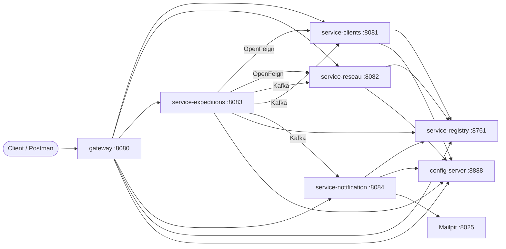
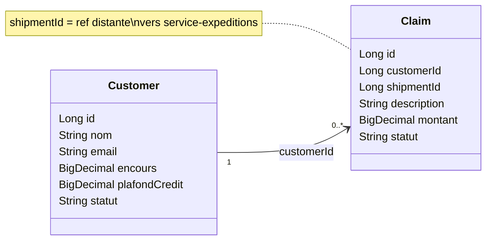
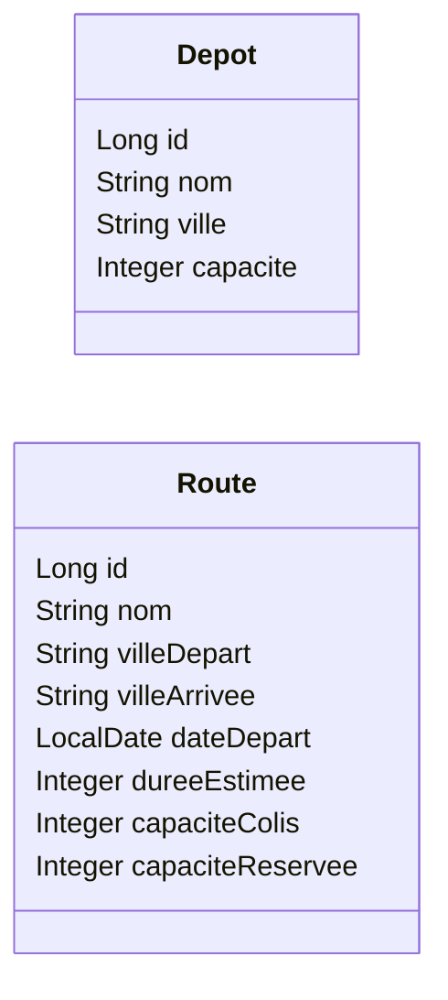
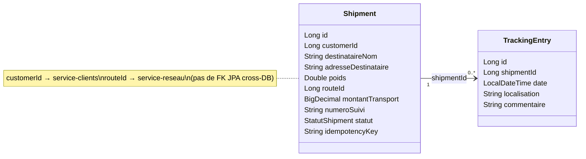

# Quick-Ship

Projet **J2EE Avancée 2027** (5IDSI) — Fiche 16.  
Dépôt : https://github.com/Badr0h/quick-ship

Transport de colis entre entrepôts : un colis est accepté sur une tournée, suivi à chaque étape, livré avec preuve ; les colis perdus ou retournés déclenchent automatiquement une réclamation client.

## Cycle de vie du Colis

```
EN_ATTENTE → EN_TRANSIT → LIVRE / RETOUR / PERDU
```

> Un Colis = 1 expéditeur + 1 destinataire + 1 tournée + 1 numéro de suivi

## Architecture



| Module | Port | Rôle | Entités |
|--------|------|------|---------|
| service-registry | 8761 | Eureka | — |
| config-server | 8888 | Config native (`config-repo/`) | — |
| gateway | 8080 | Routage dynamique Eureka | — |
| service-clients | 8081 | Expéditeurs & réclamations | Customer, Claim |
| service-reseau | 8082 | Dépôts & tournées | Depot, Route |
| service-expeditions ⭐ | 8083 | Colis & suivi | Shipment, TrackingEntry |
| service-notification | 8084 | E-mails (Kafka → Mailpit) | — |

## Diagrammes de classes (références distantes)

Les IDs distants (`customerId`, `routeId`, `shipmentId`) **ne sont pas des FK JPA** entre bases : chaque service a sa propre H2.







## Prérequis

- Java 17+ (projet configuré Java 17)
- Maven 3.9+
- Docker (Kafka KRaft + Mailpit)

## Démarrage

```bash
docker compose up -d
```

Ordre recommandé des apps Spring Boot :

1. `config-server` (8888)
2. `service-registry` (8761)
3. `gateway` (8080)
4. `service-clients` (8081)
5. `service-reseau` (8082)
6. `service-expeditions` (8083)
7. `service-notification` (8084)

Interfaces utiles :

- Eureka : http://localhost:8761
- Kafka UI : http://localhost:8090
- Mailpit : http://localhost:8025

## Règles métier clés (V7 Kafka)

- **Création colis** : vérifie customer/encours/plafond + destination (`villeArrivee`) via Feign ; publie `shipment.requested` ; capacité réservée atomiquement côté réseau.
- **Départ** : uniquement si `capaciteReservee` ; publie `shipment.in-transit` **sans** second décompte.
- **Livraison** : libère capacité **une seule fois** (si réservé), augmente encours, notifie.
- **Retour / Perdu** : libère si réservé, ouvre **une seule** Claim, notifie.

## Endpoints principaux

Via Gateway (préfixe = nom du service Eureka en minuscules) :

- `GET/POST http://localhost:8080/service-clients/customers`
- `GET/POST http://localhost:8080/service-reseau/depots|routes`
- `POST http://localhost:8080/service-expeditions/shipments/new`
- `GET http://localhost:8080/service-expeditions/shipments/{id}/full`

Collection Postman : [`postman/Quick-Ship.postman_collection.json`](postman/Quick-Ship.postman_collection.json)

## Jalons Classroom — tags & checkout

| Tag / branche | Contenu | Checkout |
|---------------|---------|----------|
| `v1.0` | CRUD Depot, Route, Customer | `git checkout v1.0` |
| `v2.0` | Eureka + Gateway | `git checkout v2.0` |
| `v3.0` | Config Server | `git checkout v3.0` |
| `v4.0` | OpenFeign + consultation enrichie + destination | `git checkout v4.0` |
| `v5.0` | RabbitMQ + service-notification | `git checkout v5.0` |
| `v6.0` / branche `main` | Resilience4j (CB/Retry/Bulkhead/timeout) + RateLimiter consultation + ControllerAdvice + idempotence | `git checkout v6.0` ou `main` |
| `v7.0-release` / branche `v7.0` | Kafka event-driven (remplace RabbitMQ) | `git checkout v7.0` |

> **Historique** : l’implémentation V1→V6 a été livrée de façon consolidée puis taguée pour Classroom (pas de commits fantômes intermédiaires). Le tag `v6.0` pointe vers `main` à jour ; `v1.0`…`v5.0` marquent le même socle pour la remise par jalon.

**Rate limiting (TP V6)** : Resilience4j `@RateLimiter("consultation")` sur `GET /shipments/{id}/full` dans `service-expeditions` (repli données locales). Pas de Redis/`RequestRateLimiter` Gateway — conforme au PDF TP V6.

Docs sources : [`docs/`](docs/) · Fiche : [`docs/fiche-quick-ship.md`](docs/fiche-quick-ship.md)  
**Guide complet V0→V7 + oral :** [`docs/GUIDE-TOUT-COMPRENDRE-QUICK-SHIP.pdf`](docs/GUIDE-TOUT-COMPRENDRE-QUICK-SHIP.pdf)  
**Diagrammes (PDF images) :** [`docs/DIAGRAMMES-QUICK-SHIP.pdf`](docs/DIAGRAMMES-QUICK-SHIP.pdf) · PNG : [`docs/diagrams/`](docs/diagrams/)

## Branche V7 (Kafka) — détail

```bash
git checkout v7.0
docker compose up -d   # Mailpit + Kafka KRaft + Kafka UI
```

| Topic | Producteur | Consommateurs |
|-------|------------|---------------|
| `shipment.requested` | expeditions | reseau |
| `shipment.capacity.reserved` / `rejected` | reseau | expeditions |
| `shipment.in-transit` | expeditions | reseau |
| `shipment.delivered` | expeditions | reseau, clients (+ notification) |
| `parcel.returned` / `parcel.lost` | expeditions | reseau, clients (+ notification) |
| `notification.email.requested` | expeditions | notification |

Idempotence : table `processed_event` dans chaque consommateur (y compris notification) + clé Kafka = `shipmentId`.
