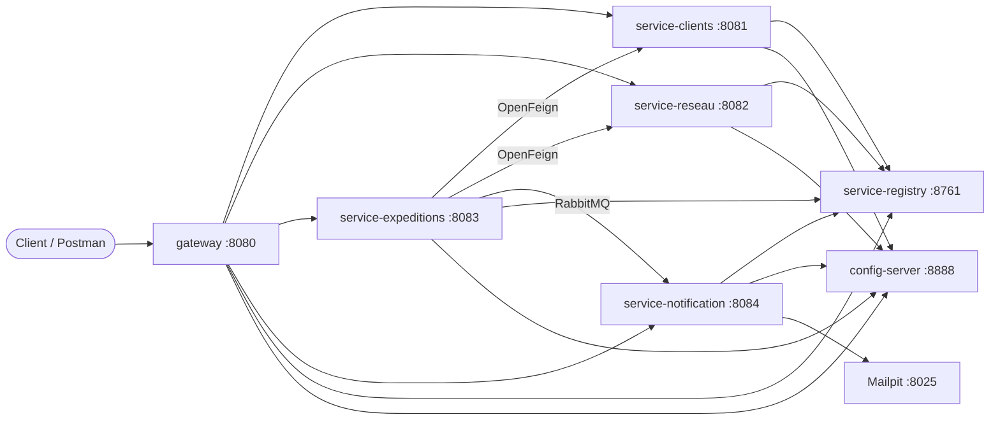

# Quick-Ship

Projet **J2EE Avancée 2027** (5IDSI) — Fiche 16.  
Dépôt : https://github.com/Badr0h/quick-ship

Transport de colis entre entrepôts : un colis est accepté sur une tournée, suivi à chaque étape, livré avec preuve ; les colis perdus ou retournés déclenchent automatiquement une réclamation client.

## Cycle de vie du Colis

```
EN_ATTENTE → EN_TRANSIT → LIVRE / RETOUR / PERDU
```

> Un Colis = 1 expéditeur + 1 destinataire + 1 tournée + 1 numéro de suivi

## Architecture



| Module | Port | Rôle | Entités |
|--------|------|------|---------|
| service-registry | 8761 | Eureka | — |
| config-server | 8888 | Config native (`config-repo/`) | — |
| gateway | 8080 | Routage dynamique Eureka | — |
| service-clients | 8081 | Expéditeurs & réclamations | Customer, Claim |
| service-reseau | 8082 | Dépôts & tournées | Depot, Route |
| service-expeditions ⭐ | 8083 | Colis & suivi | Shipment, TrackingEntry |
| service-notification | 8084 | E-mails (RabbitMQ → Mailpit) | — |

## Prérequis

- Java 17+ (projet configuré Java 17)
- Maven 3.9+
- Docker (RabbitMQ + Mailpit)

## Démarrage

```bash
docker compose up -d
```

Ordre recommandé des apps Spring Boot :

1. `config-server` (8888)
2. `service-registry` (8761)
3. `gateway` (8080)
4. `service-clients` (8081)
5. `service-reseau` (8082)
6. `service-expeditions` (8083)
7. `service-notification` (8084)

Interfaces utiles :

- Eureka : http://localhost:8761
- RabbitMQ UI : http://localhost:15672 (`tp` / `tp123`)
- Mailpit : http://localhost:8025

## Règles métier clés

- **Création colis** (`POST /shipments/new` + header `idempotencyKey`) : vérifie customer/encours/plafond, vérifie capacité tournée, réserve 1 unité, calcule `montantTransport = poids * 10 + 50`.
- **Départ** : `EN_ATTENTE → EN_TRANSIT` sans second décompte de capacité.
- **Livraison** : libère capacité une seule fois, augmente encours, notifie.
- **Retour / Perdu** : libère capacité, ouvre **une seule** Claim, notifie.

## Endpoints principaux

Via Gateway (préfixe = nom du service Eureka en minuscules) :

- `GET/POST http://localhost:8080/service-clients/customers`
- `GET/POST http://localhost:8080/service-reseau/depots|routes`
- `POST http://localhost:8080/service-expeditions/shipments/new`
- `GET http://localhost:8080/service-expeditions/shipments/{id}/full`

Collection Postman : [`postman/Quick-Ship.postman_collection.json`](postman/Quick-Ship.postman_collection.json)

## Jalons

| Jalon | Contenu |
|-------|---------|
| Init | Conception (ce README) |
| V1 | CRUD Depot, Route, Customer |
| V2 | Eureka + Gateway |
| V3 | Config Server |
| V4 | Shipment / Tracking / Claim + OpenFeign + consultation enrichie |
| V5 | RabbitMQ + service-notification |
| V6 | Resilience4j + ControllerAdvice + idempotence |
| V7 | Kafka event-driven (branche `v7.0`) |

Docs sources : [`docs/`](docs/) · Fiche : [`docs/fiche-quick-ship.md`](docs/fiche-quick-ship.md)


## Branche V7 (Kafka)

Branche Git : `v7.0`

```bash
git checkout v7.0
docker compose up -d   # Mailpit + Kafka KRaft + Kafka UI
```

Topics :

| Topic | Producteur | Consommateurs |
|-------|------------|---------------|
| `shipment.requested` | expeditions | reseau |
| `shipment.capacity.reserved` / `rejected` | reseau | expeditions |
| `shipment.in-transit` | expeditions | reseau |
| `shipment.delivered` | expeditions | reseau, clients, (+ notification via topic dédié) |
| `parcel.returned` / `parcel.lost` | expeditions | reseau, clients, (+ notification) |
| `notification.email.requested` | expeditions | notification |

Kafka UI : http://localhost:8090

Idempotence : table `processed_event` dans chaque consommateur + clé Kafka = `shipmentId`.
